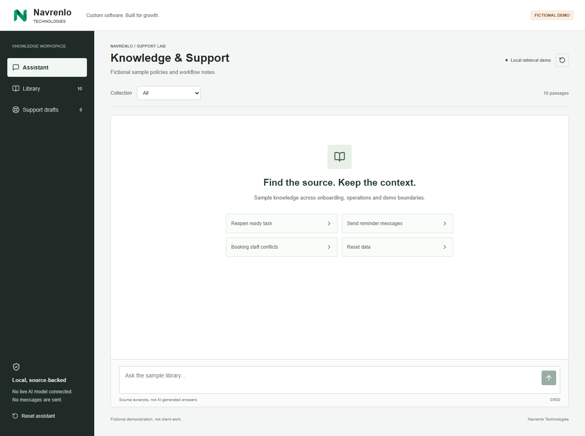

# Navrenlo Knowledge and Support Assistant

Version 0.1.0. Fictional portfolio demonstration, not client work or measured outcomes.

## Preview

Development preview: http://127.0.0.1:5177/

With Node.js installed, install dependencies and build the project before starting its local preview:

```sh
npm ci
npm run build
npm run preview
```

Open http://127.0.0.1:5178/. To develop, use `npm ci`, `npm run dev`. Verification: `npm test`, `npm run build`, then `node scripts/check-browser.mjs` with the development server running and Microsoft Edge installed.

## Walkthrough

1. Select **Reopen ready task**. The response displays an exact excerpt from the fictional readiness policy.
2. Open **Readiness and handover** to inspect the source. Escape returns focus to its link.
3. Search **quantum mars hologram**. No source is returned; the demo does not invent an answer.
4. Create a support draft, enter fictional notes and save. Open **Support drafts**, edit the saved draft and mark it **Reviewed**.
5. In **Library**, filter for bookings. Change the collection to Onboarding to verify collection isolation.
6. Reload: conversations and drafts remain in this tab session. Reset assistant with confirmation to clear only this demo.

## Honest boundaries

This is local source retrieval, not a connected LLM, semantic AI or production support system. MiniSearch indexes ten fictional passages. AND matching requires every non-stop-word term; prefix matching is enabled, fuzzy matching is disabled. Longer natural-language queries may need shortening. Results are up to three ranked excerpts, not generated answers or confidence estimates.

No external model, email, ticket submission, background automation, accounts, analytics or payments. No real client information should be entered. Session storage is local to the tab, not encrypted cloud persistence. If storage fails, a warning explains that changes are memory-only. Latest 100 conversation turns are retained. At 100 drafts, new draft creation is blocked visibly; existing drafts can still be edited or explicitly deleted.

Brand: Navrenlo Technologies. Custom software. Built for growth. Contact: navrenlotech@gmail.com.

See `docs/architecture.md`, `docs/verification.md` and `screenshots/`. Dependencies, generated builds, caches and local test output are not committed.


